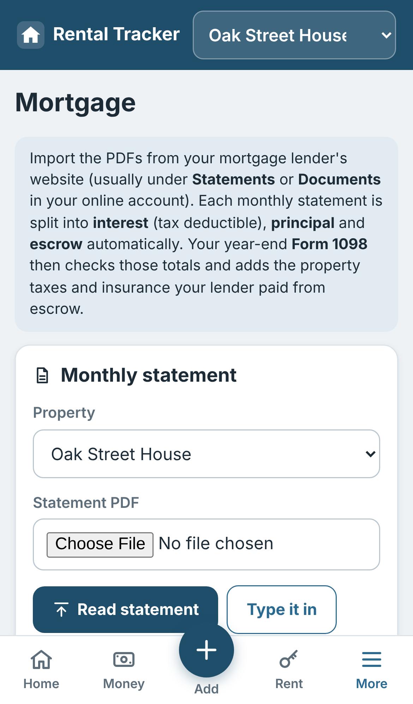
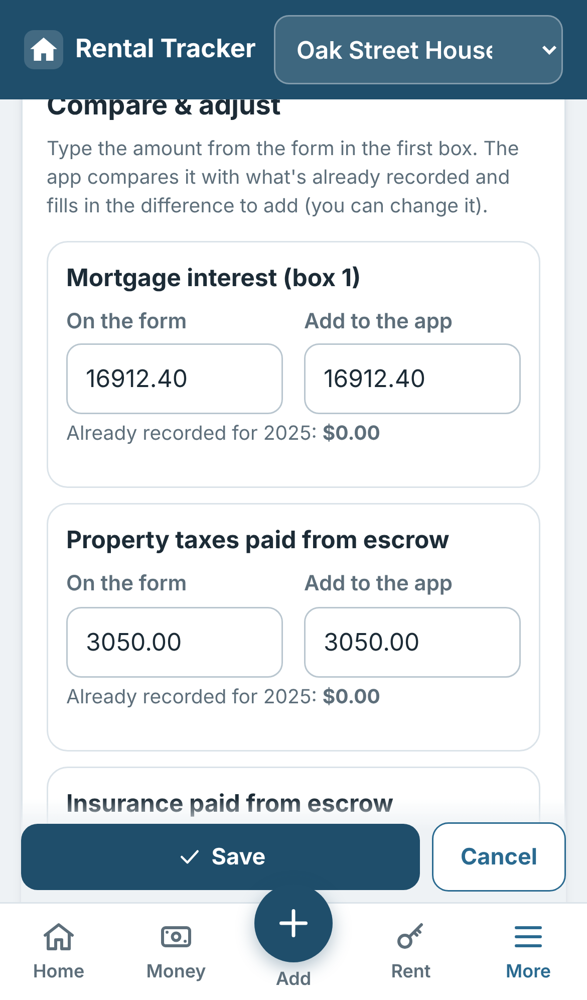

# Rental Property Tracker

A simple, private web app for landlords. Track income and expenses for one or many rental properties,
see who has paid rent, get maintenance reminders, and print a tax-ready Schedule E summary at year end.

It runs on your own computer or a Raspberry Pi with Docker. Your data stays in the `data/` folder and is
never sent anywhere. It's built to be used from your phone: open it in your phone's browser on your home Wi-Fi.

## Features

**Money**
- **Income and expenses** for every property, with net cash flow per month and per year.
- **Multiple properties.** Switch between them at the top of the page, or pick *All properties* for combined totals.
- **Tax-friendly categories** that match the lines of IRS Schedule E, with a short hint under each one.
- **Receipts.** Attach a photo (straight from your phone camera) or a PDF to any expense.
- **Recurring bills** such as HOA, the management fee, insurance, property taxes and the mortgage. Set them up
  once and they're added automatically each time they come due.
- **Search and filter** by text, year, category, vendor, date range or amount, then **export to CSV**.

**Mortgage (any US lender)**
- **Import your monthly mortgage statement (PDF).** The app reads the *Past Payments Breakdown* that every
  US mortgage statement is required to include, and splits the payment into **interest** (tax deductible),
  **principal** and **escrow**. You check the numbers on a review screen before anything is saved.
- **Import your year-end Form 1098 (PDF).** The app reads box 1 (mortgage interest), box 5 (mortgage insurance)
  and the property taxes and insurance your lender paid from escrow. It compares them with what's recorded and
  fills in the difference, so your Schedule E matches what your lender reported to the IRS.
- Duplicate files are detected, every import can be undone, and you can **type the numbers in** if a PDF can't be read.

**Rent & tenants**
- **Leases** with tenant contact info, rent, deposit, due day and grace period.
- **This month at a glance**: paid, due, late or partial. Late rent shows up on the Home screen.
  One tap on **Mark paid** records the payment.
- **Rent roll**: a 12-month grid per tenant. Tap any late month to record the payment.
- A warning when a **lease ends within 60 days**.

**Upkeep**
- **Maintenance reminders** that repeat (HVAC filter every 3 months, smoke detectors every 6...),
  with one-tap suggestions for common landlord tasks.
- Tap **Done** to log it, optionally with its cost and a receipt. The next due date is set for you.

**Vendors**
- A list of contractors with tap-to-call, what you paid each one, and a **1099 flag** for anyone paid $600 or more for services in a year.

**Reports**
- **Schedule E summary** per property and year (PDF or CSV).
- **Depreciation** of the building and of capital improvements (roof, HVAC, appliances), calculated with the straight-line method.
- **Investment numbers**: net operating income, cap rate, cash-on-cash return, expense ratio and monthly cash flow.
- **Year-over-year** comparison and spending by category.
- **Year-end PDF report** with everything above plus every transaction.

**Peace of mind**
- **Automatic daily backups** in `data/backups` (the last 14 days are kept).
- **One-click backup** download (database + receipts as a .zip).
- **Excel import** from the original spreadsheet layout.
- Upgrades happen automatically on start; your data is copied to `data/backup-before-upgrade.db` first.
- Light and dark mode, and works on any screen size. No login: it's meant for your private home network.

## Mortgage statement & Form 1098 import

1. Download the PDF from your mortgage lender's website, usually under **Statements** or **Documents** in your
   online account. Monthly statements are there, and your **Form 1098** appears by January 31.
2. In the app go to **More → Mortgage**, pick the property and the PDF, and tap **Read statement** (or **Read 1098**).
3. Check the numbers on the review screen and tap **Save**.

**What gets recorded**

| From the monthly statement | Category | On Schedule E? | In cash flow? |
|---|---|---|---|
| Interest | Mortgage interest | Yes (line 12) | Yes |
| Principal | Mortgage principal | No | Yes |
| Escrow | Mortgage escrow | No (see below) | Yes |
| Fees / late charges | Other | Yes (line 19) | Yes |

| From Form 1098 | What happens |
|---|---|
| Box 1 - mortgage interest | Compared with the interest already recorded for that year; the difference is added as an adjustment |
| Property taxes paid from escrow | Added as *Property taxes*, marked **paid from escrow** |
| Insurance paid from escrow | Added as *Insurance*, marked **paid from escrow** (if the 1098 doesn't list it, take it from your annual escrow statement) |
| Box 5 - mortgage insurance premiums | Added as *Insurance*, marked **paid from escrow** |

**Why "paid from escrow"?** The escrow part of each payment is real money leaving your account, so it counts in
cash flow. But the tax deduction happens when your lender actually *pays* the tax bill or insurance out of escrow.
Entries marked *paid from escrow* count on Schedule E but aren't counted a second time in cash flow.
You can also tick this option yourself when adding a Property taxes or Insurance expense.

**Good to know**
- Works with PDFs downloaded from the lender's website. A photo or scan has no readable text, so you'd type the numbers in.
- The reader looks for the standard section names and box labels, not one exact page layout, so it should work for
  most US lenders and loan servicers. If something comes out wrong, fix it on the review screen.
- Importing the same file twice is blocked. Importing a second 1098 for the same year replaces the first one's adjustments.
- **Undo** on the Mortgage page removes an import and every entry it created.
- If you set up a recurring bill for the mortgage, pause it when you start importing statements (the app warns you).

## Quick start
1. Install [Docker Desktop](https://www.docker.com/products/docker-desktop) (or Docker on your Pi) and start it.
2. Download this project (green **Code** button > **Download ZIP**) and unzip it.
3. Windows: double-click `Start Expenses App.bat`. Mac: double-click `Start Expenses App.command`.
   Or run `docker compose up -d --build` in the folder.
4. Open http://localhost:8080. From your phone, use `http://<computer-or-pi-ip>:8080`.

Optional settings live in `docker-compose.yml`:

| Setting | What it does |
|---|---|
| `PROPERTY_NAME` | Name of your first property (used only on the first start; rename it any time under **More → Properties**) |
| `TZ` | Your time zone, so "today" and rent due dates match your clock (e.g. `America/Chicago`) |
| `KEEP_BACKUPS` | How many daily automatic backups to keep (`0` turns them off) |

See [HOW_TO_RUN.md](HOW_TO_RUN.md) for beginner-friendly steps, including how to add it to your phone's home screen.

## Upgrading from the first version
Just pull or download the new version and start it as usual. On the first start the app:
1. saves a copy of your old database as `data/backup-before-upgrade.db`,
2. moves your expenses into your first property, mapping the old categories to the new ones (Travel → Auto & travel,
   Maintenance → Cleaning & maintenance, Office → Supplies, and so on; anything that doesn't match goes to *Other*
   with the old name kept in the notes),
3. turns each month's management fee, agent fee and HOA amounts into regular expenses
   (Management fees, Commissions and HOA dues).

The old tables are kept in the database (renamed `legacy_expenses` and `legacy_monthly`), so nothing is lost.

## Excel import format
Each sheet is named by year (e.g. `2025`). Expenses are in columns A (description), B (date), C (cost),
starting at row 3 and ending at a row labeled "Total". The 12 monthly rows are in rows 3-14 with
management fee, agent and HOA in columns F, G, H and an optional note in column I.
Importing replaces the typed-in expenses for that property and year. Income, rent and recurring bills are kept,
and a safety copy is saved first as `data/backup-before-import.db`.

## For tinkerers
Plain Python (Flask + SQLite), with no build step and no JavaScript framework.

| File | What's in it |
|---|---|
| `app.py` | The web pages and form handling |
| `store.py` | Database tables, categories, the upgrade from v1, daily backups and recurring bills |
| `reports.py` | Totals, rent roll, depreciation, Schedule E, investment metrics and the PDF |
| `mortgage.py` | Reads mortgage statements and Form 1098 PDFs (with `pypdf`) |
| `templates/` | One HTML file per page (`base.html` holds the header and the phone tab bar) |
| `static/` | `style.css`, a small `app.js` and the app icons |

Run without Docker: `pip install -r requirements.txt && python app.py`

> The tax figures are estimates to help you and your tax preparer. They aren't tax advice.

## License
Free to use as you wish
