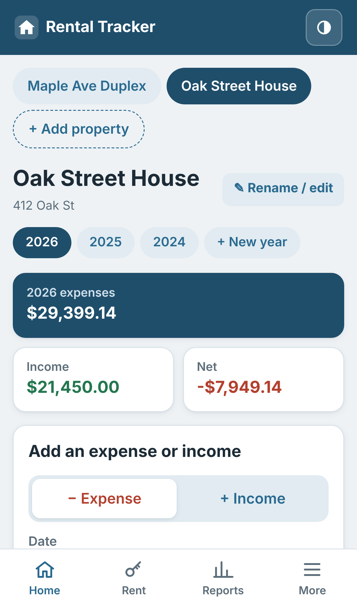
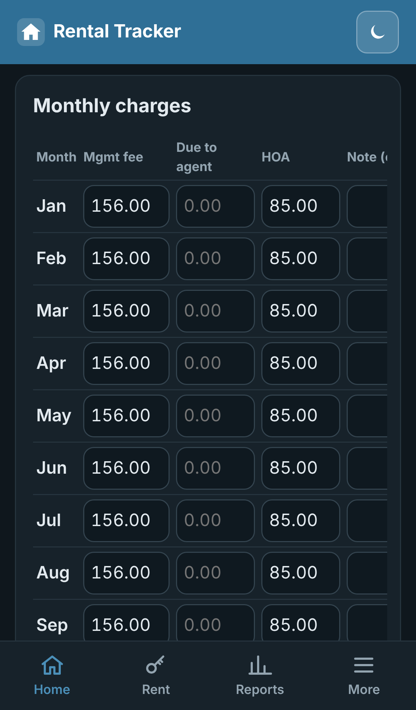
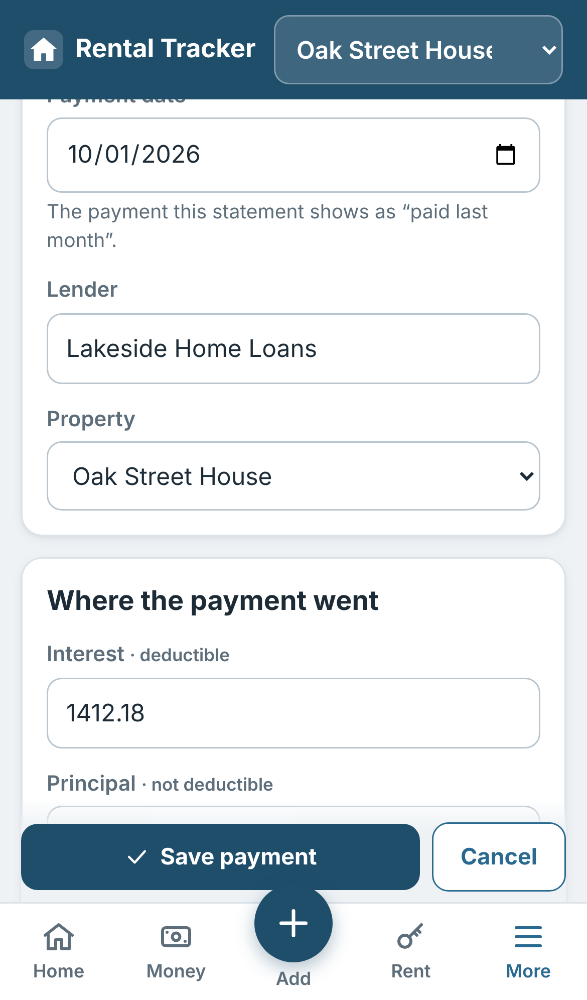
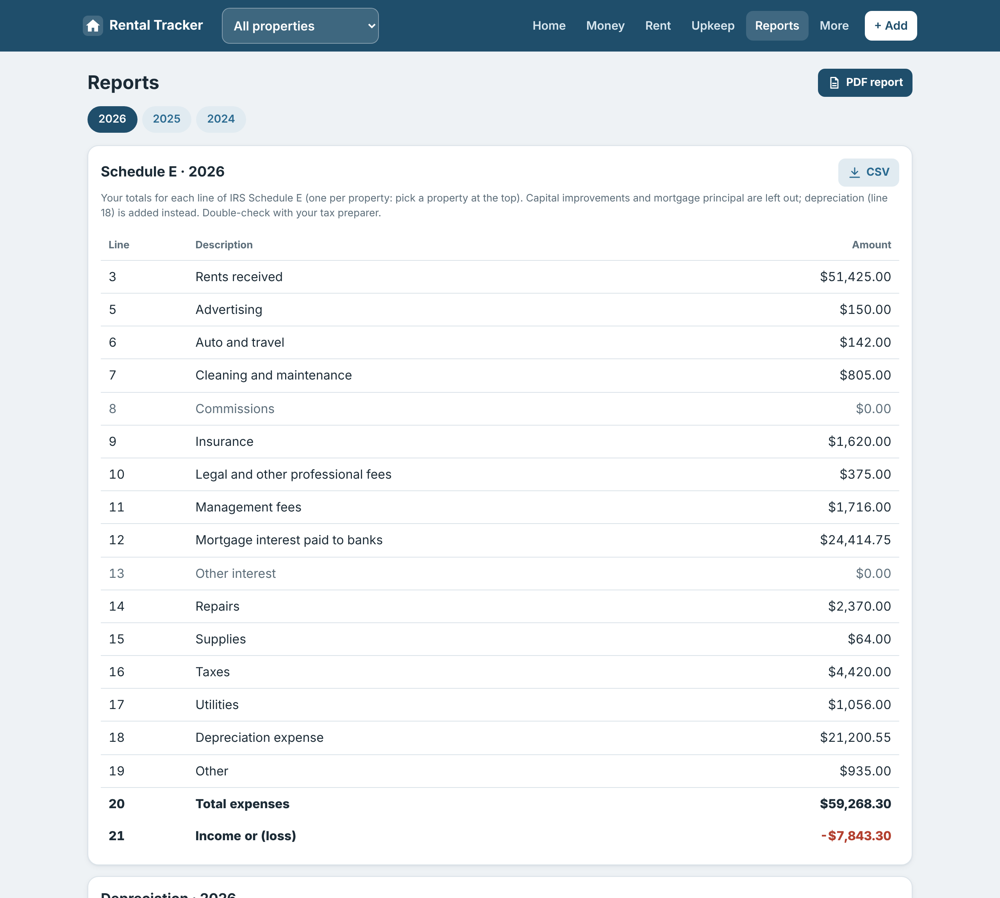

# Rental Property Tracker

A simple, private web app for tracking your rental property expenses. Pick a property, add an expense,
see your totals. It also tracks income and rent, and prints a tax-ready Schedule E summary at year end.

It runs on your own computer, a Raspberry Pi or a NAS, either with Docker or installed directly on Linux.
Your data stays in the `data/` folder and is never sent anywhere. It works great on a phone: open it in your
phone's browser on your home Wi-Fi.

<p>



</p>

## How it's organized
Four tabs: **Home · Rent · Reports · More**.

**Home: laid out like the original app**
- **Pick your property** at the top. **+ Add property** and **Rename / edit** are right there.
- **Pick a year** and see the **summary**: Total for the year, Expenses, Management fees, Due to agent and HOA.
- Two separate sections:
  - **Expenses:** add one right on the page (date, what it was, category, cost) and see that year's list.
    Notes, a receipt photo and who you paid are tucked under *Notes, receipt, paid to…*. Tap an expense to edit or delete it.
  - **Monthly charges:** the original 12-month table with **Mgmt fee**, **Due to agent**, **HOA** and **Note** columns.
    Type the amounts in and tap **Save monthly charges**.

**Rent**
- Each lease shows a **box for every month**. Tap a month to mark it **paid**, past months too, and tap again to undo.
  Late months show as *Unpaid*; partial payments show the amount received.
- Leases hold tenant contact info, rent, deposit and due day.

**Reports**
- **Schedule E summary** per property and year (PDF or CSV), using categories that match the IRS form.
- Month-by-month chart, **depreciation** (building and big upgrades like a roof), **investment numbers**
  (net operating income, cap rate, cash-on-cash), year-over-year comparison, spending by category and a 1099 check.
- **Year-end PDF report** with every entry.

**More**
- **Properties**: add, rename or remove.
- **Recurring bills**: optional. Set a bill up once and it's added every month automatically (a recurring
  management fee or HOA fills in the Monthly charges table for you).
- **Mortgage**: import your lender's monthly statement and Form 1098 PDFs (details below).
- **Search & export**: find any entry and download a CSV.
- **Vendors** (with tap-to-call and a 1099 check) and **Upkeep** (maintenance reminders).
- **Appearance**: Automatic, Light or Dark mode (also the button at the top right).
- **Backup** download, **Excel import**, and **About & what's new** (release notes).

**Peace of mind**
- **Automatic daily backups** in `data/backups` (the last 14 days are kept) and a one-click download of everything.
- Upgrades happen automatically on start; your data is copied to `data/backup-before-upgrade.db` first.
- No login: it's meant for your private home network.


## Mortgage statement & Form 1098 import

<p>



</p>

1. Download the PDF from your mortgage lender's website, usually under **Statements** or **Documents** in your
   online account. Monthly statements are there, and your **Form 1098** appears by January 31.
2. In the app go to **More → Mortgage**, pick the property and the PDF, and tap **Read statement** (or **Read 1098**).
3. Check the numbers on the review screen and tap **Save**.

**What gets recorded**

| From the monthly statement | Category | On Schedule E? | In cash flow? |
|---|---|---|---|
| Interest | Mortgage interest | Yes (line 12) | Yes |
| Principal | Mortgage principal | No | Yes |
| Escrow | Mortgage escrow | No (see below) | Yes |
| Fees / late charges | Other | Yes (line 19) | Yes |

| From Form 1098 | What happens |
|---|---|
| Box 1 - mortgage interest | Compared with the interest already recorded for that year; the difference is added as an adjustment |
| Property taxes paid from escrow | Added as *Property taxes*, marked **paid from escrow** |
| Insurance paid from escrow | Added as *Insurance*, marked **paid from escrow** (if the 1098 doesn't list it, take it from your annual escrow statement) |
| Box 5 - mortgage insurance premiums | Added as *Insurance*, marked **paid from escrow** |

**Why "paid from escrow"?** The escrow part of each payment is real money leaving your account, so it counts in
cash flow. But the tax deduction happens when your lender actually *pays* the tax bill or insurance out of escrow.
Entries marked *paid from escrow* count on Schedule E but aren't counted a second time in cash flow.
You can also tick this option yourself when adding a Property taxes or Insurance expense.

**Good to know**
- Works with PDFs downloaded from the lender's website, including the official IRS form filled in electronically and
  lenders' own year-end statements. A photo or scan has no readable text, so you'd type the numbers in.
- The reader looks for the standard section names and box labels, not one exact page layout, so it should work for
  most US lenders and loan servicers. If something comes out wrong, fix it on the review screen.
- Importing the same file twice is blocked. Importing a second 1098 for the same year replaces the first one's adjustments.
- **Undo** on the Mortgage page removes an import and every entry it created.
- If you set up a recurring bill for the mortgage, pause it when you start importing statements (the app warns you).

## Install

There are two ways to run it. Both store your data in the `data/` folder and use port **8090**.

| | Option A: Docker | Option B: Direct install (Linux) |
|---|---|---|
| Works on | Windows, Mac, Linux, Raspberry Pi, Docker-capable NAS | Linux with systemd: Raspberry Pi OS, Debian, Ubuntu, Fedora... |
| You need | Docker | Python 3.9+ (`python3-venv` on Debian/Ubuntu/Pi OS) |
| Starts on boot | Yes (Docker restarts it) | Yes (as a systemd service) |
| Update | `git pull && docker compose up -d --build` | `git pull && ./install.sh` |
| Settings file | `docker-compose.yml` | `rental-tracker.env` |

### Option A: Docker
1. Install [Docker Desktop](https://www.docker.com/products/docker-desktop) (or Docker on your Pi/Linux machine) and start it.
2. Download this project (green **Code** button > **Download ZIP** and unzip it, or `git clone` it).
3. Windows: double-click `Start Expenses App.bat`. Mac: double-click `Start Expenses App.command`.
   Or run `docker compose up -d --build` in the folder.
4. Open http://localhost:8090. From your phone, use `http://<computer-ip>:8090`.

Settings live in `docker-compose.yml`:

| Setting | What it does |
|---|---|
| `PROPERTY_NAME` | Name of your first property (used only on the first start; rename it any time under **More → Properties**) |
| `TZ` | Your time zone, so "today" and rent due dates match your clock (e.g. `America/Chicago`) |
| `KEEP_BACKUPS` | How many daily automatic backups to keep (`0` turns them off) |

### Option B: Direct install on Linux (no Docker)
```bash
sudo apt install git python3 python3-venv      # Debian / Ubuntu / Raspberry Pi OS (Fedora: sudo dnf install git python3)
git clone https://github.com/dannyspace21/Rental-Property-Expense-Tracker.git
cd Rental-Property-Expense-Tracker
./install.sh
```
Run it as your normal user, not with `sudo`. The script:
- asks for your property name,
- sets up the app with its own copy of its Python libraries in `.venv` (nothing is installed system-wide),
- installs a `rental-tracker` service that starts on boot and restarts if it ever crashes. It asks for your password once for this step, and the app runs as your user, not root.

Then open `http://<computer-ip>:8090`.

| Task | Command |
|---|---|
| Check it's running | `systemctl status rental-tracker` |
| See the logs | `journalctl -u rental-tracker -n 50` |
| Update to the latest version | `git pull && ./install.sh` |
| Change settings | edit `rental-tracker.env`, then `./install.sh` |
| Install without the background service | `./install.sh --no-service` (it prints the command to start it yourself) |
| Remove the service (keeps your data) | `./install.sh --uninstall` |

Settings live in `rental-tracker.env`, which is created on the first install and never overwritten:
`PORT`, `PROPERTY_NAME`, `KEEP_BACKUPS` and `TZ`. Without `TZ`, the app uses the computer's own time zone.

See [HOW_TO_RUN.md](HOW_TO_RUN.md) for beginner-friendly steps, including how to add it to your phone's home screen.

## Upgrading from the first version
Just pull or download the new version and start it as usual. On the first start the app:
1. saves a copy of your old database as `data/backup-before-upgrade.db`,
2. moves your expenses into your first property, mapping the old categories to the new ones (Travel → Auto & travel,
   Maintenance → Cleaning & maintenance, Office → Supplies, and so on; anything that doesn't match goes to *Other*
   with the old name kept in the notes),
3. turns each month's management fee, agent fee and HOA amounts into regular expenses
   (Management fees, Commissions and HOA dues).

The old tables are kept in the database (renamed `legacy_expenses` and `legacy_monthly`), so nothing is lost.

## Excel import format
Each sheet is named by year (e.g. `2025`). Expenses are in columns A (description), B (date), C (cost),
starting at row 3 and ending at a row labeled "Total". The 12 monthly rows are in rows 3-14 with
management fee, agent and HOA in columns F, G, H and an optional note in column I.
Importing replaces the typed-in expenses for that property and year. Income, rent and recurring bills are kept,
and a safety copy is saved first as `data/backup-before-import.db`.



## For tinkerers
Plain Python (Flask + SQLite), with no build step and no JavaScript framework.

| File | What's in it |
|---|---|
| `app.py` | The web pages and form handling |
| `store.py` | Database tables, categories, the upgrade from v1, daily backups and recurring bills |
| `reports.py` | Totals, rent roll, depreciation, Schedule E, investment metrics and the PDF |
| `mortgage.py` | Reads mortgage statements and Form 1098 PDFs (with `pypdf`) |
| `install.sh` | Direct Linux install: Python environment + systemd service |
| `templates/` | One HTML file per page (`base.html` holds the header and the phone tab bar) |
| `CHANGELOG.md` | Release notes, shown in the app under **More → About & what's new** |
| `static/` | `style.css`, a small `app.js` and the app icons |

Run without Docker for development: `pip install -r requirements.txt && python app.py` (port 8090, or set `PORT`).

> The tax figures are estimates to help you and your tax preparer. They aren't tax advice.

## License
Free to use as you wish
